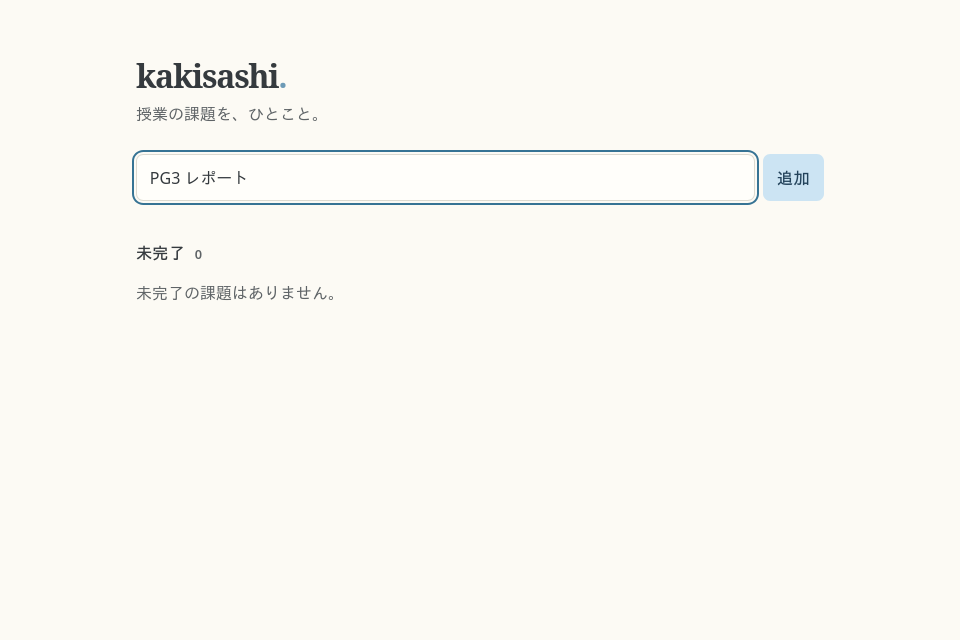
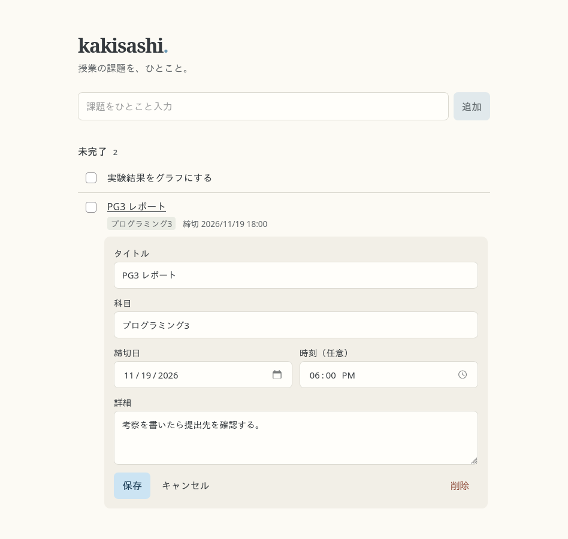
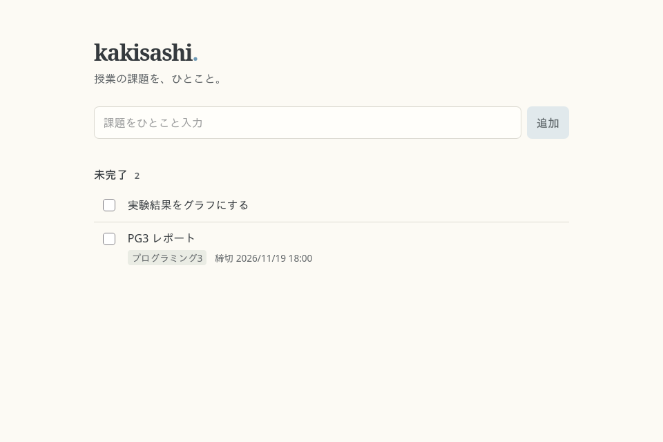
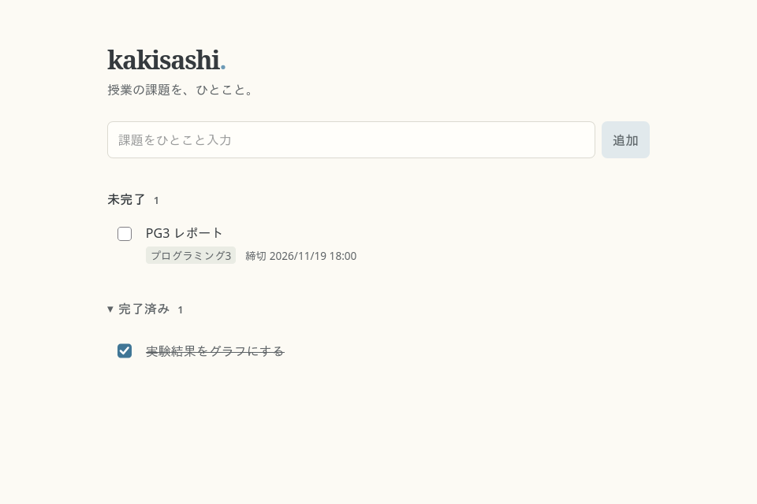
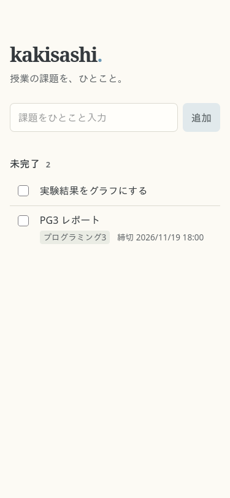

# kakisashi

授業の連絡を見たら、課題名だけ控えておく。kakisashi（書きさし）は、授業で出た課題のための一行メモ帳です。

公開 URL：<https://kakisashi.arca0928.dev>

## 作ったきっかけ

これまでは課題を一覧にまとめず、何が出ていたかは自分の記憶と授業連絡のログを頼りにしていました。課題を一か所に控えるなら、連絡を見たその場で「PG3 レポート」とだけ書いて、すぐ授業に戻れるものが欲しい。これが kakisashi の出発点です。

登録に必要なのはタイトルだけです。提出方法を覚えておきたいときや、締切を確認したときは、あとから同じ行に科目・締切・詳細を書き足せます。一言で用が足りた課題は、そのまま完了にして構いません。「未整理」の一覧を別に作らなかったのは、メモを整理することより、課題そのものに時間を使いたいからです。

## 画面と使い方

課題名を入力して Enter を押すか、「追加」を選びます。新しい課題は未完了一覧の先頭に並びます。



タイトルを選ぶと、その行で科目・締切・詳細を編集できます。日付だけ決まっている課題は、時刻を空欄にして保存します。





チェックした課題は「完了済み」に移ります。元に戻すには「完了済み」を開いてチェックを外します。



スマホでも同じ画面で登録・編集できます。保存先は端末ごとなので、PC の一覧とは別になります。



## 採用技術

- 画面：TypeScript、React、TanStack Start、Tailwind CSS
- 保存先：ブラウザの `localStorage`。課題は入力した端末のブラウザに保存し、ほかの端末とは同期しません。
- デプロイ先：Cloudflare Workers
- 開発環境：Nix Flakes、pnpm、Vite

## ローカルでの起動

リポジトリのルートで次のコマンドを実行し、<http://localhost:3000> を開きます。

```sh
nix develop
pnpm install
pnpm dev
```

`direnv` を使う場合は、`nix develop` の代わりに `direnv allow` で開発環境に入れます。NixOS で Cloudflare のローカル実行に使う `workerd` は、開発シェルの起動時と `pnpm install` の際に自動で設定されます。
